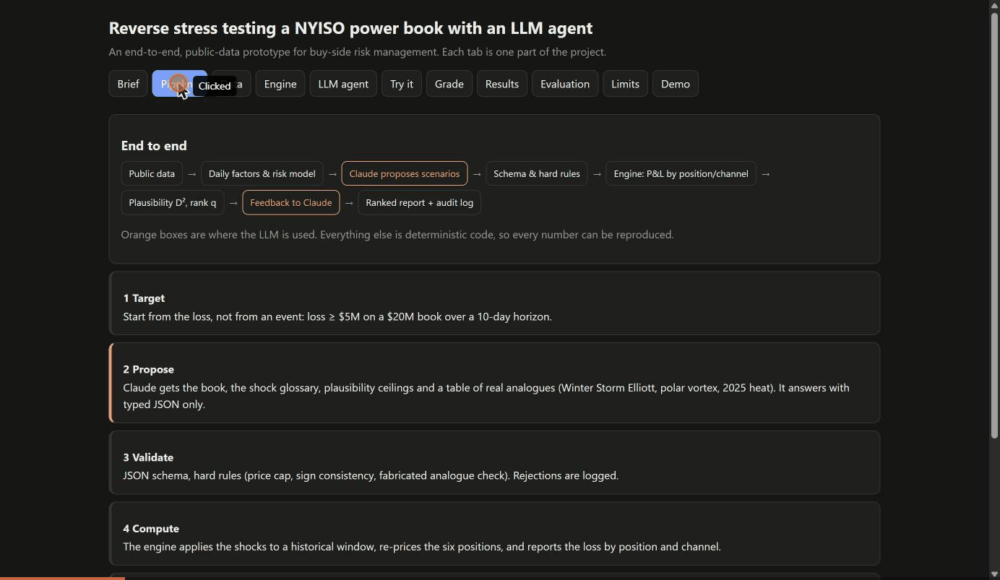

# Reverse stress testing a NYISO power book with an LLM agent

Course project, IEOR 4723 (AI-Augmented Investment Management, Columbia), solo. It answers the handout topic *reverse stress testing agent* for a power trading book: instead of asking "what do I lose if X happens?", it asks **"which plausible worlds lose me at least $5M (25% of capital)?"**

Claude proposes coherent stress scenarios as typed shock vectors (no price forecasts). A factor-based engine computes the P&L by position and channel, and plausibility is checked against 2019-2025 history. The deliverable is a **ranked set of scenarios** with narrative, shock vector, P&L decomposition and an audit log, compared with random search, an optimizer and a conditional-Gaussian baseline at equal engine budget.

| | |
|---|---|
| **Report** | [REPORT.md](REPORT.md) (PDF: [REPORT.pdf](REPORT.pdf)) |
| **Interactive demo** | https://claude.ai/artifact/UnzNC9VinSZX1dX6wi8K2Y : write a scenario in plain English, run the engine, read Claude's interpretation, grade scenarios blind |
| **Ranked deliverable** | [outputs/RANKED_SCENARIOS_daily_sonnet.md](outputs/RANKED_SCENARIOS_daily_sonnet.md) |
| **Audit log of the search** | `outputs/live_daily_sonnet/audit_log*.jsonl` (every prompt, answer, hash and engine verdict) |



## How the project answers the brief

| The brief asks for | Where it is |
|---|---|
| Claude proposes narratively coherent scenarios, mapped to a structured shock vector via a schema | `revstress/agent/` prompt and JSON schema; 8 typed shocks with ranges |
| A factor-based risk engine computes the P&L | `revstress/shock.py`, `revstress/book.py`: daily price model with seasonal harmonics and persistence, P&L by position and channel |
| Results feed back so the agent refines toward breaching, plausible scenarios | `revstress/pipeline_real.py`: engine loss, plausibility class, sensitivities and penalties returned each call |
| Plausibility given historical covariance | `revstress/risk/`: D² on five daily factors per season, rank q against 255 historical windows |
| Ranked scenarios with narratives, shock vectors, P&L decomposition, audit log | `scripts/make_ranked_report.py`, `outputs/RANKED_SCENARIOS_*.md`, `audit_log*.jsonl` |
| Keep the LLM from generating fantasy | schema, hard rules, analogue table with existence check, marginal ceilings, soft penalties, blind coherence judge (section 4.5 of the report) |
| Evaluation | random, optimizer and conditional-Gaussian baselines at equal budget, hypothesis stated in advance, model comparison, anchoring ablation, negative results reported |

## Where the LLM is used, and where it is not
| Step | Who |
|---|---|
| Propose scenarios as JSON shock vectors, read an analogue table of real events | Claude (Sonnet 5.5 or Haiku 5.5) |
| Schema check, hard rules, price cap, fabricated-analogue check | code |
| Shock to price path, book P&L, loss | code (deterministic engine) |
| Plausibility: D² on five factors, rank q against 255 historical 10-day windows | code |
| Blind coherence grade of each scenario | a different model (Opus 5.5); human grading in the demo's Grade tab |
| Plain-language scenario to numbers, interpretation of a result | Claude, in the interactive demo only |

## Key results (single seed, 5 repeats per run; see the report for caveats)
| Arm | Breaches per repeat | Median D² | Engine calls |
|---|---|---|---|
| Claude (Sonnet 5.5), daily-model engine | 11.2 ± 0.4 | 156 | 42 |
| Optimizer | 8.0 ± 1.4 | 93 | 144 |
| Conditional-Gaussian | 0.2 ± 0.4 | 89 | 144 |
| Random | 0 | n/a | 144 |

The optimizer wins on plausibility, as stated in advance. Claude's lead in breach count is not comparable with earlier runs: the pre-declared book sizing rule is not met on the final engine. Every ranked scenario loses mostly through one channel (N.Y.C. retail load obligation), so the book, not the search, limits diversity. Sonnet finds about 2.7x more breaches than Haiku at equal protocol, with no gain in coherence; Haiku's severity depends on the stated target, Sonnet's does not.

## Quick start
```
pip install -r requirements.txt
python -E -P -m pytest -q                                  # 262 tests, offline, about 2.5 min
python -E -P run_nyiso_demo.py --seed 0 --budget 144 --repeats 5      # offline, scripted Claude arm (not Claude results)
python -E -P run_nyiso_demo.py --live --i-understand-cost --model claude-sonnet-5-5 --repeats 5   # live API, about 12 min
python -E -P scripts/export_ui_data.py && python -E -P scripts/export_engine.py && cd ui && python -m http.server 8000
```
Live runs cost tokens (about 1.2M per 5-repeat run) and need the explicit `--i-understand-cost` flag. Copy `.env.example` to `.env` with your key; it is read in-process and never printed or committed. The offline run uses a scripted client whose outputs are never presented as Claude results.

## Layout
- `revstress/` engine, risk model, agent loop, baselines, evaluation (`pipeline_real.py` is the entry point)
- `scripts/` ranked report, factor report, daily factor model, anchoring ablation, LLM coherence grader, book-size scans, UI exports
- `tests/` 262 unit and integration tests; `ui/` static front end with an in-browser port of the engine (checked against Python by `node ui/check_engine.js`)
- `outputs/` results of every run the report cites (scenarios, audit logs, comparison tables, figures)
- `docs/` project plan with the pre-stated hypothesis, hand-off notes, earlier report draft, technical README
- `data/processed/` daily aggregates from public NYISO, EIA and NOAA data. Raw downloads are not included (`data/raw/` is ignored); NYISO only publishes a general legal notice, no data-specific terms.

## Limits
Single seed per run, a Claude arm that uses fewer engine calls than the baselines, daily averaging that understates hourly spikes, a stated $5,000 price cap, no New York gas history, LLM-only coherence grades, and a book that cannot lose on several channels. They are listed with their evidence in section 8 of the report.
