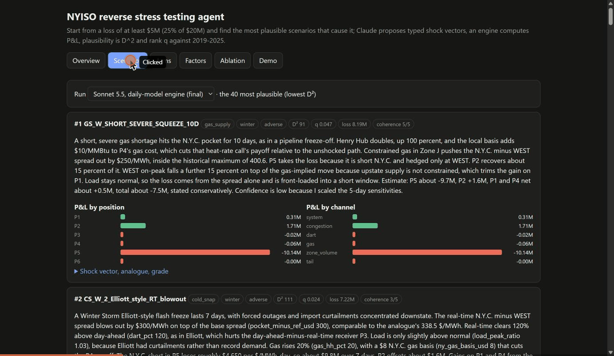

# Reverse stress testing a NYISO power book with an LLM agent

Course project, IEOR 4723 (AI-Augmented Investment Management), solo. It answers the handout topic *reverse stress testing agent* for a power trading book: instead of asking "what do I lose if X happens?", it asks **"which plausible worlds lose me at least $5M (25% of capital)?"**

Claude proposes coherent stress scenarios as typed shock vectors (no price forecasts). A factor-based engine computes the P&L by position and channel, and plausibility is checked against 2019-2025 history. The deliverable is a **ranked set of scenarios** with narrative, shock vector, P&L decomposition and an audit log, compared with random search, an optimizer and a conditional-Gaussian baseline at equal engine budget.



## Where the LLM is used, and where it is not
| Step | Who |
|---|---|
| Propose scenarios as JSON shock vectors, read an analogue table of real events | Claude (Sonnet 5.5 or Haiku 5.5) |
| Schema check, hard rules, price cap, fabricated-analogue check | code |
| Shock to price path, book P&L, loss | code (deterministic engine) |
| Plausibility: D^2 on five factors, rank q against 255 historical 10-day windows | code |
| Blind coherence grade of each scenario | a different model (Opus 5.5); human grading pending |

## Key results (single seed, 5 repeats per run; see docs/REPORT_DRAFT.md for caveats)
| Arm | Breaches per repeat | Median D^2 |
|---|---|---|
| Claude (Sonnet 5.5), daily-model engine | 11.2 +- 0.4 | 156 |
| Optimizer | 8.0 +- 1.4 | 93 |
| Conditional-Gaussian | 0.2 +- 0.4 | 89 |
| Random | 0 | n/a |

The optimizer wins on plausibility, as stated in advance. Claude's lead in breach count is not comparable with earlier runs: the pre-declared book sizing rule is not met on the final engine. Every ranked scenario loses mostly through one channel (N.Y.C. retail load obligation), so the book, not the search, limits diversity.

## Quick start
```
pip install numpy pandas scipy scikit-learn matplotlib pytest anthropic
python -E -P -m pytest -q                                  # 260+ tests, offline
python -E -P run_nyiso_demo.py --seed 0 --budget 144 --repeats 5      # offline, scripted Claude arm
python -E -P run_nyiso_demo.py --live --i-understand-cost --model claude-sonnet-5-5 --repeats 5   # live API, needs ANTHROPIC_API_KEY in .env
python -E -P scripts/export_ui_data.py && python -E -P scripts/export_engine.py && cd ui && python -m http.server 8000
```
Live runs cost tokens (about 1.2M per 5-repeat run) and need the explicit `--i-understand-cost` flag. A `.env` file with the key is read in-process and never printed or committed.

## Layout
- `revstress/` engine, risk model, agent loop, baselines, evaluation (`pipeline_real.py` is the entry point)
- `scripts/` ranked report, factor report, daily factor model, anchoring ablation, LLM coherence grader, book-size scans, UI exports
- `tests/` unit and integration tests; `ui/` static front end with an in-browser port of the engine (checked against Python by `node ui/check_engine.js`)
- `outputs/` results of the runs that the report cites; `docs/` plan, hand-off notes, report draft, technical README
- `data/processed/` daily aggregates from public NYISO, EIA and NOAA data. Raw downloads are not included (`data/raw/` is ignored); NYISO only publishes a general legal notice, no data-specific terms.

## Limits
Single seed per run, a Claude arm that uses fewer engine calls than the baselines, daily averaging that understates hourly spikes, a stated $5,000 price cap, no New York gas history, LLM-only coherence grades, and a book that cannot lose on several channels. They are listed with their evidence in `docs/REPORT_DRAFT.md`.
