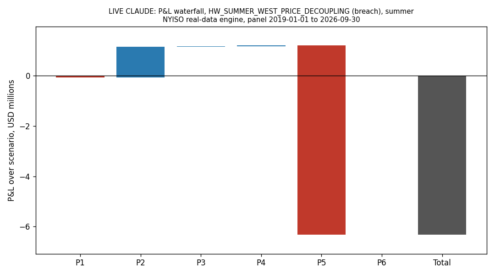
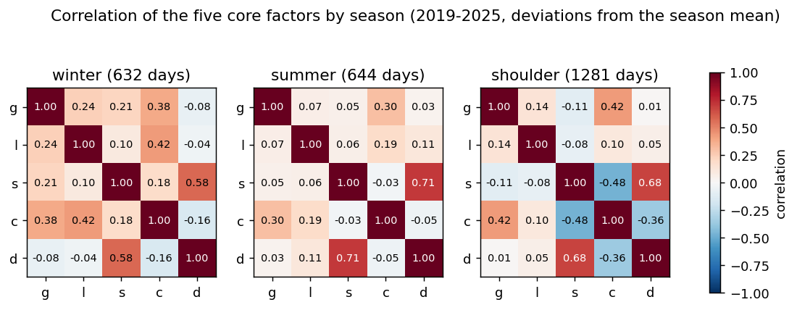

# Reverse stress testing a NYISO power book with an LLM agent

IEOR 4723, AI-Augmented Investment Management, Columbia University. Final project (solo), October 2026.
Topic: handout example 6, *Reverse Stress Testing Agent*, adapted to the New York wholesale power market.

Interactive version: https://claude.ai/artifact/UnzNC9VinSZX1dX6wi8K2Y (the reader can write a scenario in plain English, run the engine, and grade scenarios). Code, data aggregates and run outputs: this repository.

## Abstract

Conventional stress testing starts from a scenario and computes the loss. Reverse stress testing starts from the loss and asks which plausible worlds produce it. I built an agentic loop in which Claude proposes narratively coherent stress scenarios for a six-position NYISO power book, maps each one to a typed shock vector through a schema, and a deterministic factor-based engine computes the P&L by position and by channel. The target is a loss of at least $5M, 25% of a $20M capital allocation. Plausibility is measured against 2019-2025 history with a Mahalanobis distance D² on five daily factors and a rank q against 255 non-overlapping 10-day windows. The agent is compared at equal engine budget with random search, a numerical optimizer and a conditional-Gaussian "most likely scenario" baseline, with the hypothesis stated in advance. On the final engine, Claude (Sonnet 5.5) found 11.2 ± 0.4 distinct breaching scenarios per repeat against 8.0 ± 1.4 for the optimizer and 0.2 for the conditional-Gaussian search, but with the worst plausibility (median D² 156 versus 93) and while using 42 engine calls against 144. As predicted, the optimizer wins on plausibility. Claude's advantage is in coverage of driver families and in readable, auditable scenarios, not in finding more plausible worlds. Two negative results are reported: no book could be sized to lose through several channels, and the severity-anchoring ablation shows that Haiku's scenarios depend on the stated target while Sonnet's do not. Human coherence grading is left to the reader through the interface.

## 1. Problem and objective

A power trading desk holds a book of swaps, spread positions, a heat-rate option, a retail load obligation and a tail option on NYISO prices. The desk wants to know not "what happens if gas doubles" but "what are the most plausible worlds in which this book loses a quarter of its capital". The handout asks for:

1. an agentic loop in which Claude proposes coherent scenarios as structured shock vectors via a schema;
2. a factor-based risk engine that computes the P&L;
3. a feedback loop so the agent refines toward scenarios that breach the threshold while staying plausible under the historical covariance;
4. a ranked set of scenarios with narratives, shock vectors, P&L decomposition and an audit log of the search;
5. a method to keep the LLM from generating fantasy.

Each of these maps to a component of this project (section 4). The objective and a four-question gate (does the step start from the loss target; does Claude only propose shock vectors, never prices; is plausibility kept or measured, never relaxed to pass; does the step feed the ranked deliverable, the P&L view or the audit log) were written down before the work and applied to every step (`docs/HANDOFF.md`).

## 2. Data

All data are public and were aggregated to daily values. Raw downloads stay on the local disk; only aggregates are in the repository (`data/processed/`). NYISO publishes only a general legal notice with no data-specific terms (checked 2026-10-28), so the project cites NYISO as the source and redistributes aggregates only.

| Series | Source | Use |
|---|---|---|
| Day-ahead and real-time zonal prices, WEST (upstate reference) and N.Y.C. (load pocket), hourly, aggregated to on-peak and around-the-clock daily means | NYISO MIS | Price model, factors s, c, d; P&L |
| Zonal load, hourly, aggregated to daily peak | NYISO MIS | Factor l; P5 volume |
| Henry Hub spot gas, daily | EIA | Factor g; P4 fuel cost |
| Temperature, Central Park and Buffalo | NOAA | Seasonal normal of load |
| Fuel mix (wind, nuclear, hydro, dual fuel), daily | NYISO | Daily factor model test (section 4.4) |

Panel 2019-01-01 to 2026-09-30, fit window 2019-2025 (2,557 days: winter 632, summer 644, shoulder 1,281). Four verified event days serve as analogues for the agent (Winter Storm Elliott, 23-24 Dec 2022; January 2025 cold; June 2025 heat; a 2014 replay panel for out-of-sample checks).

## 3. The book

Six positions, $20M allocated capital, target loss $5M, horizon 30 days. Sizes were set by a pre-declared rule on an earlier version of the engine (see 6.4).

| Position | What | Channel | Size |
|---|---|---|---|
| P1 | Long swap on the WEST on-peak price | system | 100 MW |
| P2 | Long N.Y.C. minus WEST spread, around the clock | congestion | 25 MW |
| P3 | Short day-ahead minus real-time at WEST | dart | 50 MW |
| P4 | Heat-rate call on WEST against Henry Hub gas plus a N.Y.C. basis (premium 8.29 $/MWh, fair value) | gas | 50 MW |
| P5 | N.Y.C. retail load obligation, hedged at WEST (short the pocket, long the reference) | zone_volume | 140 MW |
| P6 | Short tail call on the WEST on-peak price (premium 0.53 $/MWh) | tail | 25 MW |

The channel labels are the P&L decomposition the deliverable reports. The scenario price cap is $5,000/MWh, a stated assumption.

## 4. Method

### 4.1 Pipeline and division of labour

| Step | Who |
|---|---|
| Propose 3 scenarios per call for a given driver family and season, as JSON: narrative, typed shock vector, duration, analogue, confidence, self-estimated loss | Claude (Sonnet 5.5; Haiku 5.5 as the cheap comparison) |
| Schema validation, hard rules (sign consistency, ranges, duration), price cap, check that any cited analogue exists in the table given to the model | code |
| Shock vector to daily price path; book P&L by position and channel; loss | code, deterministic engine |
| Plausibility: D² on five factors, rank q against history, marginal ceilings, severity class | code |
| Feedback: engine loss, plausibility class, one-at-a-time sensitivities and the soft-penalty state are returned to the agent for the next call | code to Claude |
| Blind coherence grade of each ranked scenario | a different model (Opus 5.5); human grading through the interface |

Claude never sees prices to forecast. It sees the book (what each position gains and loses on), the shock vocabulary with ranges, a short table of verified analogue events, and after each call the engine's verdict on its previous proposals.

### 4.2 Shock vector

Eight typed shocks, all expressed relative to the unshocked path: Henry Hub change (%), N.Y.C. gas basis ($/MMBtu), peak load ratio, large-load shortfall (MW), extra WEST on-peak move beyond what gas and load imply (%), extra N.Y.C. minus WEST spread ($/MWh), real-time versus day-ahead (%), duration (days, at most 30). The engine applies the shock for the stated duration and, in the final engine, lets price-level and spread effects decay afterwards as φ^k with φ about 0.55 and 0.59, the AR(1) coefficients of the residual factors. P&L is the shocked path minus the unshocked path.

### 4.3 Plausibility

Five daily factors: g (log Henry Hub), l (log peak load versus its seasonal normal), s (residual of the log WEST on-peak price after gas, load, two annual harmonics and load × season), c (N.Y.C. minus WEST on-peak spread, $/MWh), d (log real-time over day-ahead at WEST). Means and covariances are estimated per season. A scenario's 10-day average factor deviation gives D², and q is its rank among the 255 non-overlapping 10-day windows of 2019-2025. q is a rank, not a probability. Severity classes: ordinary (q > 5%), adverse (1-5%), severe (< 1%); a scenario is implausible if any marginal shock exceeds 1.25 times the historical extreme or a hard rule fails. A *breach* is a distinct scenario with loss ≥ $5M, q < 5%, all hard rules passed and not implausible.

### 4.4 Why a daily factor model

The first engine had season intercepts and snap-back shocks. A walk-forward out-of-sample test of daily factor models (`scripts/daily_factor_model.py`, `outputs/daily_model/walk_forward.csv`) showed what explains daily prices:

| Target | Gas + load | + season | + weather | + persistence | + wind, nuclear, hydro |
|---|---|---|---|---|---|
| log WEST on-peak, R² | 0.47 | 0.48 | 0.49 | **0.68** | 0.49 |
| N.Y.C. − WEST spread, R² | 0.11 | 0.19 | 0.21 | **0.42** | 0.25 |
| log RT/DA, R² | −0.01 | 0.00 | 0.00 | **0.14** | 0.07 |

Persistence of yesterday's residual is the strongest daily factor; season adds a little; fuel-mix factors add almost nothing. The final engine therefore has seasonal harmonics in the price model and a persistence tail after the shock. The price residual autocorrelation falls from 0.62 to 0.24 once persistence is in.

### 4.5 Keeping the LLM from fantasy

Five mechanisms, all in code: a strict JSON schema with ranges; hard rules (a shock that contradicts its own narrative is rejected; durations bounded); an analogue table so the model can cite real events, with a check that any cited analogue exists; marginal ceilings at 1.25 times history; a soft penalty when the agent keeps reusing the same driver family. Every call is logged (`outputs/*/audit_log*.jsonl`): prompt version and hash, full messages in and out, cache key, model, client kind, engine verdicts. In the final run, 0 of 177 scenarios were rejected by a hard rule; the soft penalty for driver overuse fired on 64-71% of proposals, which says the agent concentrates on what works (cold snaps) once it has found it.

### 4.6 Baselines and protocol

Random search, a SLSQP optimizer that minimizes D² subject to loss ≥ target, and a conditional-Gaussian search (the most likely factor state given the loss, after Sparviero & Viola), each with 144 engine calls per repeat (36 per seed, 4 seeds). The agent runs 14 calls of 3 scenarios per repeat and uses only the engine calls it needs (42). Five repeats per run, seed 0, repeats in parallel threads, baselines in worker processes. Metrics: breaches per repeat, median D² and q, driver and channel coverage, rule pass share, stated versus engine loss, coherence.

**Hypothesis stated in advance** (`docs/PLAN.md`, section 1): the optimizer wins on D². Claude must win on coverage (distinct driver families and channels) and on coherence; if it does not, the result is reported as negative.

## 5. Results on the final engine

Run `outputs/live_daily_sonnet`: Sonnet 5.5, seed 0, 5 repeats, 177 scenarios, 0.86M tokens in and 0.32M out, about 12 minutes.

| Arm | Breaches per repeat | Median D² | Median q | Driver coverage | Engine calls |
|---|---|---|---|---|---|
| Claude (Sonnet 5.5) | **11.2 ± 0.4** | 156 | 0.014 | **0.34** | 42 |
| Optimizer | 8.0 ± 1.4 | **93** | 0.041 | 0.20 | 144 |
| Conditional-Gaussian | 0.2 ± 0.4 | 89 | 0.047 | 0.03 | 144 |
| Random | 0 | n/a | n/a | 0 | 144 |

Channel coverage is 0.17 for Claude and the optimizer: every breach loses mostly through P5, the N.Y.C. load obligation. Claude's stated loss is within 20% of the engine loss for 92% of scenarios (median relative error 7%). The ranking of breaches is robust to the window length (5, 10, 14 days) and to the replay tolerance τ (`sensitivity.csv`).



### 5.1 The ranked deliverable

59 of 177 scenarios are ranked-eligible (`outputs/RANKED_SCENARIOS_daily_sonnet.md`). The top three, most plausible first:

| Rank | Scenario | Season, days | Shock vector (non-neutral) | Loss | D², q | Analogue |
|---|---|---|---|---|---|---|
| 1 | Short severe gas squeeze in the N.Y.C. pocket | winter, 10 | gas +100%, basis +$10, WEST −15%, spread +$250 | $8.19M (stated 6.50) | 91, 0.047 | none, confidence low |
| 2 | Elliott-style flash freeze with real-time blowout | winter, 7 | gas +20%, basis +$8, load 1.03, spread +$300, RT/DA +120% | $7.22M (stated 7.00) | 111, 0.024 | Winter Storm Elliott, Dec 2022 |
| 3 | Summer heat wave with cheap gas and deep negative dart | summer, 30 | gas −30%, load 1.02, WEST −40%, spread +$32, RT/DA −60% | $5.44M (stated 5.50) | 134, 0.020 | none, confidence low |

For rank 2 the engine gives P1 +0.92M, P2 +1.51M, P3 −0.47M, P4 +0.17M, P5 −9.28M, P6 −0.08M: the long spread P2 recovers a sixth of what the load obligation loses, which is exactly the hedge-mismatch story the narrative tells. The narratives carry the model's own position-by-position estimates, and these are close to the engine's.

### 5.2 Coherence

A blind Opus 5.5 judge graded the 59 ranked scenarios on five items (causal chain, shocks explained, duration consistent, analogue relevant, no contradiction): mean 0.664; causal chain 43/59, shocks explained 27/59, duration 57/59, analogue 33/59, no contradiction 36/59 (`outputs/coherence_opus_daily_sonnet`). The weak items are "shocks explained" (the narrative names a shock without saying why that size) and "no contradiction" (typically a summer heat wave that nonetheless assumes soft upstate prices). On the 18 Haiku scenarios graded by two LLM judges, Sonnet and Opus agree with Cohen's κ from 0.47 (no contradiction) to 1.00 (duration); Opus is the stricter judge. An LLM judge is not the pre-registered human rater; the interface lets a human grade 20 blind scenarios and reports agreement with Opus.

### 5.3 Generator comparison: Sonnet 5.5 versus Haiku 5.5

Same protocol on the earlier engine (season intercepts, snap-back shocks; baselines identical in both runs: optimizer 15.4 breaches, conditional-Gaussian 4.4, random 0).

| | Sonnet 5.5 | Haiku 5.5 |
|---|---|---|
| Breaches per repeat | 9.8 ± 2.8 | 3.6 ± 2.3 |
| Median D² | 159 | 145 |
| Ranked-eligible / scenarios | 55 / 170 | 18 / 165 |
| Stated loss within 20% of engine loss | 96% | 78-95% |
| Coherence, same judge (Opus 5.5) | 0.578 | 0.611 |
| Wall time, 5 parallel repeats | 12 min | 4.7 min |

Sonnet finds about 2.7 times more breaches than Haiku in this draw, with no gain in coherence and none in plausibility. Five separate single-repeat Haiku runs (seeds 0-4) gave 10, 6, 9, 9, 4 breaches: the agent's breach count is unstable across draws, and no single mean should be quoted as its level.

### 5.4 Severity anchoring

Does the agent reach the tail because it understands the book, or because the prompt says $5M? One run per model with the target hidden:

| | Target shown | Target hidden |
|---|---|---|
| Haiku 5.5: scenarios, median loss, share above target, breaches | 63, $5.77M, 73%, 11 | 24, $1.95M, 12.5%, 0 |
| Sonnet 5.5 | 33, $6.70M, 100%, 10 | 33, $8.64M, 88%, 3 |

Haiku's severity follows the stated target; without it the proposals do not reach the tail. Sonnet without a target proposes harsher worlds, and fewer count as breaches because more fall beyond the plausibility limits. Anchoring is therefore model-dependent, not a general property of the loop; the two arms are not the same task, so this shows dependence on the target, not that the scenarios are invented.

## 6. What the factors say



| Pair | Winter | Summer | Shoulder | Reading |
|---|---|---|---|---|
| spread c, load l | 0.42 | 0.19 | 0.10 | Cold raises load and the city spread together, only in winter: the mechanism behind every top-ranked scenario |
| gas g, spread c | 0.38 | 0.30 | 0.42 | Gas and the spread move together in all seasons |
| residual s, dart d | 0.58 | 0.71 | 0.68 | A price above its fundamentals goes with real time above day-ahead |
| residual s, spread c | 0.18 | −0.03 | −0.48 | The sign flips with the season |

Principal components of the five standardized factors explain 34.6%, 28.2%, 17.9%, 12.7% and 6.6% of the variance: four are needed for 93%, so the covariance is used in full rather than reduced. The most extreme days by D² are all in the 2022 shoulder season (29 March, 20-21 November, 31 May 2022), driven by gas and price residuals, not by cold waves: the tail of the fitted history is a gas story while the scenarios that breach are winter spread stories. This is why winter scenarios reach q ≈ 2% with D² around 100-150 while remaining far from the historical extremes (D² 356).

### 6.1 Sizing the book: a negative result

A pre-declared rule (at least five distinct breaches per repeat, breaches on at least two channels, weakest breach q < 5%, worst historical 30-day loss below target) was applied to 48 candidate books on the final engine (`outputs/book_scan_v3`) and to 432 candidates on the earlier engine (`outputs/book_scan_v2`). None is admissible: every breach is the winter N.Y.C. load-obligation story, and the best candidate reaches 4 distinct breaches. The book keeps the sizes chosen on the earlier engine and the $5M target. The consequence is stated wherever it matters: the persistence tail makes the same shock lose 15-20% more, so the $5M target is reachable by ordinary worlds, the conditional-Gaussian point is no longer a tail event, and the breach counts of section 5 are not comparable with those of section 5.3.

## 7. Honest reading

- **Plausibility.** As predicted, the optimizer and the conditional-Gaussian search find more plausible worlds than Claude on every engine. Claude's median D² is 1.7 times the optimizer's.
- **Breach count.** Claude's lead on the final engine (11.2 versus 8.0) is real in this draw but rests on a book that is not calibrated for that engine, on one seed, and on fewer engine calls; per engine call Claude's yield is higher, but budgets are not equal.
- **Coverage.** Claude covers 0.34 of the driver families against 0.20 for the optimizer, which supports the pre-stated claim; channel coverage is identical and book-limited.
- **Coherence.** Graded by an LLM only; Opus gives 0.66 on the final run. The weak items are specific and fixable in the prompt (ask for the size of each shock to be justified), which was not done to keep the pre-registered protocol.
- **Where the agent adds value.** Not in finding the most plausible loss, which an optimizer does better; in producing scenarios a risk manager can read, check against a named analogue, trace position by position, and reject. The audit log makes every proposal reproducible from its prompt hash.

## 8. Limits

One seed per run and dispersion of 2-3 breaches across draws; a Claude arm that uses fewer engine calls than the baselines; a book that cannot lose on several channels and was not recalibrated on the final engine; daily averaging that understates hourly spikes (hourly maxima of 3,000-4,500 $/MWh vanish in 16-hour means); the $5,000 cap as a stated assumption; no daily New York gas series, so the basis is an explicit shock, not a factor; LLM-only coherence grades; a 7-year history with few independent extremes; q is a rank against 255 windows, not a probability. The analogue numbers cited by the agent come from its own table and were verified only for the four events in it.

## 9. Reproducibility

```
pip install -r requirements.txt
python -E -P -m pytest -q                                   # 262 tests, offline, about 2.5 min
python -E -P run_nyiso_demo.py --seed 0 --budget 144 --repeats 5          # offline, scripted agent (not Claude results)
python -E -P run_nyiso_demo.py --live --i-understand-cost --model claude-sonnet-5-5 --repeats 5   # live, about 1.2M tokens
python -E -P scripts/make_ranked_report.py outputs/live_daily_sonnet/scenarios.jsonl --out outputs/RANKED_SCENARIOS_daily_sonnet.md
python -E -P scripts/grade_coherence_llm.py outputs/live_daily_sonnet/scenarios.jsonl --model claude-opus-5-5 --i-understand-cost   # blind judge
```

The engine is also ported to JavaScript for the interface (`ui/engine.js`) and checked against the Python engine on 18 cases (`tests/test_ui_engine_port.py`).

## References

- Course handout, *Group Project, Examples*, IEOR 4723, example 6.
- Sparviero and Viola, conditional-Gaussian most-likely scenario for reverse stress testing, arXiv 2606.09274 (the baseline of section 4.6).
- NYISO, Market and Operational Data (MIS); EIA, Henry Hub spot price; NOAA, Global Historical Climatology Network daily.
- Anthropic, Claude Sonnet 5.5, Haiku 5.5 and Opus 5.5 through the Messages API.
